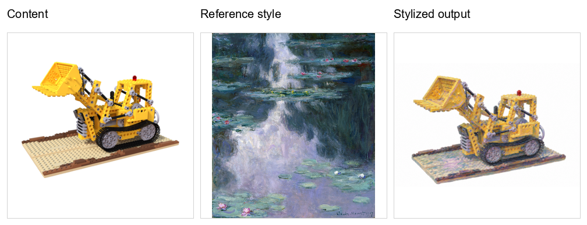
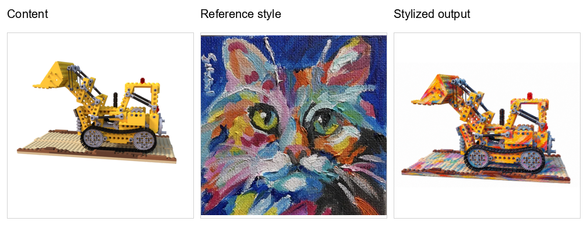
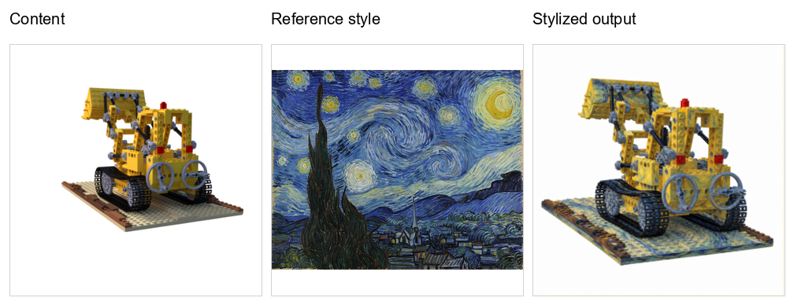
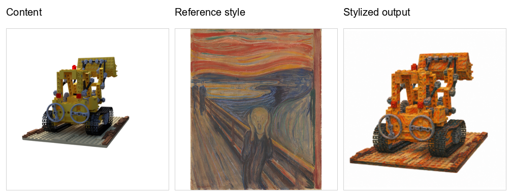

# Feature-Space 3D Style Transfer with Coordinate-Based Neural Radiance Fields

> **Research code and engineering reference implementation**

This repository implements a two-stage neural rendering pipeline *"Feature-Space 3D Style Transfer with Coordinate-Based Neural Radiance Fields"* (FsRS) for
zero-shot-style transfer over a NeRF-style scene representation. It combines
explicit camera-conditioned volume rendering with learned feature-space
stylization: Stage 1 reconstructs a scene as a continuous 3D feature field,
and Stage 2 transforms the rendered feature representation using a
sampling-invariant content path and a deferred style path.

The project is organized as a reproducible research artifact rather than a
single monolithic demo. It includes source modules, serialized training state,
dataset metadata, reference styles, qualitative outputs, checkpoint-embedded
configuration, and executable training/inference entry points.

## Research summary

### Problem setting

Given posed multi-view images of a scene and a reference style image, the
system produces a stylized rendering while preserving the scene's
camera-dependent geometry. The implementation uses the synthetic Blender
**Lego** scene in the NeRF dataset format and supports arbitrary images in the
flat `data/style/` directory as style references.

### Method

The implementation is factored into the following differentiable stages:

1. **Ray construction and sampling.** Camera intrinsics are derived from
   `camera_angle_x`; camera poses transform pixel directions into world-space
   rays. Stratified samples are drawn between `t_n` and `t_f`.
2. **Continuous feature field.** A positional-encoded MLP predicts a positive
   density and a 256-dimensional content feature for every sampled 3D point.
3. **Differentiable volume rendering.** Density-derived transmittance and
   alpha weights integrate point features into a structured 128 x 128
   representation.
4. **Stage 1 reconstruction.** A CNN decoder maps the rendered feature grid to
   RGB. Feature reconstruction, RGB reconstruction, and VGG perceptual losses
   train the scene representation and decoder.
5. **Stage 2 stylization.** The Stage 1 feature field is frozen. SICT applies
   volume-aware normalization and feature-space attention; DST estimates
   style statistics and a learned transformation; a trainable decoder produces
   the final stylized image.
6. **Style supervision.** VGG-19 content loss, multi-layer mean/std matching,
   Gram-matrix loss, and feature/image total variation regularize the output.

This decomposition makes the geometry reusable: Stage 2 learns stylization
without relearning the Stage 1 radiance/feature field.

### Engineering design

- **Explicit contracts:** `num_rays == grid_size ** 2` and decoder resolution
  checks fail early when architecture and data settings drift.
- **Memory-aware rendering:** ray chunks and gradient checkpointing reduce
  peak memory during training; inference uses a no-gradient chunked path.
- **Checkpoint completeness:** checkpoints retain model, optimizer, scheduler,
  AMP scaler, epoch, best loss, and configuration state.
- **Evaluation parity:** the same ray-generation and volume-rendering modules
  are used by training and inference.
- **Experiment transparency:** all default hyperparameters are readable in
  Python configuration dictionaries and are also embedded in checkpoints.

## Repository status

| Component | Included |
|---|---:|
| Stage 1 checkpoint | Yes — `checkpoints/stage_01/model.pth` |
| Stage 2 checkpoint | Yes — `checkpoints/stage_02/model.pth` |
| NeRF metadata and images | Yes — `data/nerf_synthetic/lego/` |
| Reference style images | Yes — `data/style/` |
| Stage 1 previews | Yes — `outputs/stage_01/` |
| Stage 2 previews | Yes — `outputs/stage_02/` |
| Publication-style result gallery | Yes — `outputs/gallery/` |
| Environment specification | No — install the packages listed below |
| Stage 2 YAML configuration | Empty — use `src/stage_02_config.py` or the checkpoint-embedded config |

## Qualitative results

The following comparisons summarize the checked-in qualitative results. Each
row is a fixed-size triptych:

**reconstructed content image + reference style image = stylized output**

The content images are `outputs/stage_01/recon_01.png` through
`recon_04.png`; the style references are respectively
`style_12.png`, `style_02.png`, `style_03.png`, and `style_06.png`; and the
stylized outputs are `outputs/stage_02/output_01.png` through
`output_04.png`. All gallery files use the same 1008 x 388 canvas, with
identical 320 x 320 image tiles and preserved aspect ratio.

| Experiment | Content + reference style + stylized output |
|---|---|
| 01 |  |
| 02 |  |
| 03 |  |
| 04 |  |

These are qualitative artifacts from the included checkpoints, not a
quantitative benchmark. They should not be interpreted as a comparison to the
original StyleRF paper unless the same data, metrics, and evaluation protocol
are reproduced.

## Relation to StyleRF

The repository follows the high-level research direction of StyleRF-style
zero-shot 3D stylization: preserve a learned scene representation while
transferring appearance in feature space. The code here is an independent
implementation with its own module boundaries, training objectives,
hyperparameters, checkpoints, and experimental outputs

## Requirements

Use Python 3.10 or newer and run from the repository root. A CUDA-enabled
PyTorch installation is strongly recommended for the default 512 x 512,
128 x 128 ray-grid configuration. CPU execution is supported in principle but
is expected to be substantially slower and may require reducing the image
resolution, ray grid, or chunk sizes.

Install PyTorch and the runtime dependencies in the environment appropriate
for your CUDA version:

```powershell
python -m venv .venv
.\.venv\Scripts\Activate.ps1
python -m pip install --upgrade pip
python -m pip install torch torchvision
python -m pip install numpy pillow matplotlib tqdm
```

`wandb` is optional and is only imported when `use_wandb=True` is enabled:

```powershell
python -m pip install wandb
```

The first Stage 1/Stage 2 run may download the pretrained ImageNet VGG-19
weights used by `src/vgg.py`. Cache these weights before running in an offline
environment.

## Data layout and preprocessing

The default paths are relative to the repository root:

```text
data/
├── nerf_synthetic/lego/
│   ├── transforms_train.json
│   ├── transforms_val.json
│   ├── transforms_test.json
│   ├── train/*.png
│   ├── val/*.png
│   └── test/*.png
└── style/
    ├── style_03.png
    ├── style_04.jpg
    └── ...
```

The dataset loader reads the camera field of view and 4 x 4 camera poses,
converts RGBA content images to tensors, composites transparent pixels onto
white to create `target_rgb`, resizes content and style images to the
configured square resolution, and pairs each content view with a random style
image for Stage 2 training. Fixed style selection is available for controlled
inference.

The included metadata contains 100 training views, 100 validation views, and
200 test views. The style loader accepts PNG, JPG, JPEG, BMP, and WebP files.

## Quick start with the included checkpoints

From the repository root:

```powershell
python src/stage_01_infer.py
python src/generate_style.py
```

`stage_01_infer.py` calls the Stage 1 evaluation helper and displays target
versus reconstruction images. `generate_style.py` loads both checkpoints,
renders one test view with a fixed style image, and displays the content,
style, and stylized result side by side.

The inference example uses test-view index `67` and style index `3`. Change
`Subset(dataset, [67])` and `fixed_idx=3` for another qualitative comparison.

## Training

The scripts are designed to run from the repository root. They use the
Python dictionaries in `src/config.py` and `src/stage_02_config.py`; they do
not parse command-line arguments.

### Stage 1: feature-field reconstruction

Stage 1 trains on `data/nerf_synthetic/lego/transforms_train.json`. The
default configuration uses 512 x 512 images, a 128 x 128 spatial ray grid
(16,384 rays), 64 stratified samples per ray, a 256-dimensional learned
content feature, and 500 epochs with warmup and cosine learning-rate
scheduling. Its objective combines feature reconstruction, RGB reconstruction,
and VGG perceptual losses.

Run:

```powershell
python src/train_stage_01.py
```

The trainer creates its configured save directory, writes checkpoints as
training progresses, and writes periodic render previews under `renders/`.
To use Weights & Biases, change `use_wandb=False` to `True` in the script and
authenticate the `wandb` client.

The shipped Stage 1 checkpoint was saved at epoch 455 and reports a stored
best loss of approximately `0.4470`. Its embedded configuration is
authoritative for loading that artifact; its historical `save_dir` is an
external path and is not required locally.

### Stage 2: stylization

Stage 2 loads the Stage 1 checkpoint, freezes the Stage 1 feature pipeline,
initializes its decoder from the Stage 1 decoder, and trains SICT, DST, and
the Stage 2 decoder. Its objective combines VGG content loss, multi-layer
AdaIN statistics, Gram loss, feature total variation, and image total
variation.

Run:

```powershell
python src/train_stage_02.py
```

Stage 2 expects `stage1_ckpt_path` to point to a compatible Stage 1
checkpoint. The source configuration currently points to
`checkpoints/stage1/g128_e256/model.pth`, while the included checkpoint is
`checkpoints/stage_01/model.pth`. Before retraining Stage 2, update
`stage1_ckpt_path` in `src/stage_02_config.py`:

```python
"stage1_ckpt_path": "checkpoints/stage_01/model.pth"
```

The included Stage 2 checkpoint was saved at epoch 212 and contains SICT, DST,
decoder, optimizer, scheduler, AMP scaler, and configuration state. Its
stored best loss is approximately `68.0052`.

### Resuming training

Neither training script exposes a resume command-line flag. Pass the
checkpoint path to the trainer constructor in the corresponding `__main__`
block:

```python
trainer = FeatureGridTrainer(
    model=model,
    train_loader=train_loader,
    loss_fn=feature_grid_objective,
    config=config,
    device=device,
    use_wandb=False,
    resume_from="path/to/stage1/checkpoint.pth",
)
```

For Stage 2, add the same `resume_from=...` keyword to the
`StyleGridTrainer(...)` call. Resume checkpoints must contain the optimizer
and scheduler state expected by that trainer.

## Loading the trained models programmatically

The supported complete-model loader is
`load_stylerf_for_inference` in `src/generate_style.py`. It reconstructs the
Stage 1 model, loads its `model_state_dict`, freezes it, constructs `FsRF`,
and loads the Stage 2 SICT, DST, and decoder state dictionaries.

Example:

```python
import torch

from config import config as stage_01_config
from generate_style import load_stylerf_for_inference
from stage1 import PreFeatureGridTrainingStagePipeline
from stage_02_config import config as stage_02_config

device = torch.device("cuda" if torch.cuda.is_available() else "cpu")

stage1 = PreFeatureGridTrainingStagePipeline(
    config=stage_01_config
).to(device)

stage1, stylerf = load_stylerf_for_inference(
    config=stage_02_config,
    stage1_model=stage1,
    stage1_checkpoint_path="checkpoints/stage_01/model.pth",
    stage2_checkpoint_path="checkpoints/stage_02/model.pth",
    device=device,
)
```

When running a custom script outside `src/`, add the source directory to
`PYTHONPATH`:

```powershell
$env:PYTHONPATH = "$PWD\src"
python path\to\your_inference_script.py
```

For a batch containing the keys produced by `StylizedNeRFDataset`, inference
is:

```python
with torch.no_grad():
    features = stage1.feature_pipeline.infer(batch)
    output = stylerf(features=features, batch=batch)

stylized_rgb = output["rgb_img"]  # (B, 3, H, W), values in [0, 1]
```

`batch` must contain `image`, `target_rgb`, `camera_angle_x`, `camera_pose`,
and `style_img`. Use `mode="fixed"` for repeatable content/style pairs and
`mode="random"` for Stage 2 training.

## Checkpoints

`checkpoints/stage_01/model.pth` contains:

```text
epoch, best_loss, config, model_state_dict,
optimizer_state_dict, scheduler_state_dict, scaler_state_dict
```

`checkpoints/stage_02/model.pth` contains:

```text
epoch, best_loss, config,
sict_pipeline_state_dict, dst_pipeline_state_dict, decoder_state_dict,
optimizer_state_dict, scheduler_state_dict, scaler_state_dict
```

Load the embedded configuration when exact architecture compatibility matters:

```python
checkpoint = torch.load(
    "checkpoints/stage_01/model.pth",
    map_location="cpu",
    weights_only=True,
)
config = checkpoint["config"]
```

Stage 2 is not a standalone scene representation: it relies on a compatible
Stage 1 checkpoint for the frozen feature field and camera-conditioned
features. Keep both checkpoints together when sharing or archiving an
experiment.

## Configuration reference

The main coupled invariants are:

- `num_rays == grid_size ** 2`;
- `img_H` and `img_W` must match the decoder configuration;
- the decoder expects exactly `grid_size ** 2` rendered rays;
- Stage 2 `content_feature_dim`, `grid_size`, and image resolution must be
  compatible with Stage 1;
- Stage 2 must initialize from a Stage 1 checkpoint with compatible tensor
  shapes.

Source defaults live in `src/config.py` and `src/stage_02_config.py`.
`checkpoints/stage_01/config.yaml` records a Stage 1 experiment summary.
`checkpoints/stage_02/config.yaml` is currently empty and should not be used
as the Stage 2 configuration. For exact reproducibility, prefer
`checkpoint["config"]` from the artifact being evaluated, then correct paths
for the local checkout.

## Code map

| File | Role |
|---|---|
| `src/train_stage_01.py` | Stage 1 trainer, scheduler, checkpointing, previews |
| `src/train_stage_02.py` | Stage 2 trainer, losses, checkpointing, previews |
| `src/stage1.py` | NeRF feature pipeline, decoder wrapper, Stage 1 losses |
| `src/stage2.py` | FsRF composition of SICT, DST, and decoder |
| `src/feature_field_learner.py` | Positional encoding and learned 3D feature field |
| `src/mlp.py` | Density and content-feature MLP |
| `src/utils.py` | Ray generation, sampling, positional encoding, volume rendering |
| `src/sict.py` | SICT and feature-space volume rendering |
| `src/dst.py` | Style statistics, learned transformation, and DST |
| `src/decoder.py` | CNN feature-grid-to-RGB decoder |
| `src/vgg.py` | Frozen VGG-19 feature extraction and normalization |
| `src/volume_norm.py` | Volume-adaptive instance normalization used by SICT |
| `src/load_dataset.py` | NeRF, style, and paired dataset classes |
| `src/generate_style.py` | Complete checkpoint loading and qualitative inference |
| `src/stage_01_infer.py` | Stage 1 qualitative evaluation entry point |
| `src/config.py` | Stage 1 source configuration |
| `src/stage_02_config.py` | Stage 2 source configuration |
| `outputs/` | Checked-in qualitative previews |
| `checkpoints/` | Checked-in model and training-state artifacts |

## Reproducibility and reporting notes

For a paper submission, record Python, PyTorch, torchvision, CUDA, and GPU
versions; the exact checkpoint-embedded configuration; random seeds and
data-loader settings; AMP and Weights & Biases settings; the content-view and
style-image indices used for qualitative figures; and the held-out split used
for metrics.

## Citation

```bibtex
TODO
```

## License

No license file is currently included. Add a license before redistributing
the code or bundled data.
